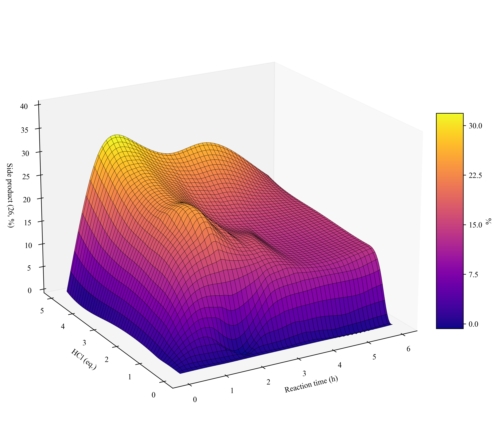

# Reaction Yield Surface Plot

A small scientific visualization project for generating a 3D surface plot of side-product formation in an organic chemistry reaction.

The plot visualizes how the percentage of side product varies with reaction time and HCl equivalents, using experimental reaction data from a master’s thesis project on acid-catalyzed amination of 4-chloro-7H-pyrrolo[2,3-d]pyrimidine.



## Overview

This project reads experimental reaction data from a CSV file, interpolates the measurements over a regular grid, and generates a publication-style 3D surface plot.

The visualization is intended to make it easier to analyze how reaction conditions influence side-product formation.

## Features

- Loads reaction data from `rx_data.csv`
- Processes side-product measurements using `pandas` and `numpy`
- Performs cubic interpolation with `scipy.interpolate.griddata`
- Generates a 3D surface plot using `matplotlib`
- Exports a high-resolution figure as `surfaceplot_MH.png`

## Variables visualized

- **x-axis:** Reaction time in hours
- **y-axis:** HCl equivalents
- **z-axis:** Side-product percentage

## Requirements

Install the required Python packages:

```bash
pip install numpy pandas matplotlib scipy
